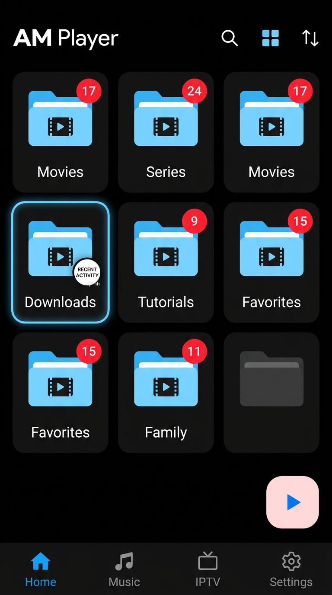
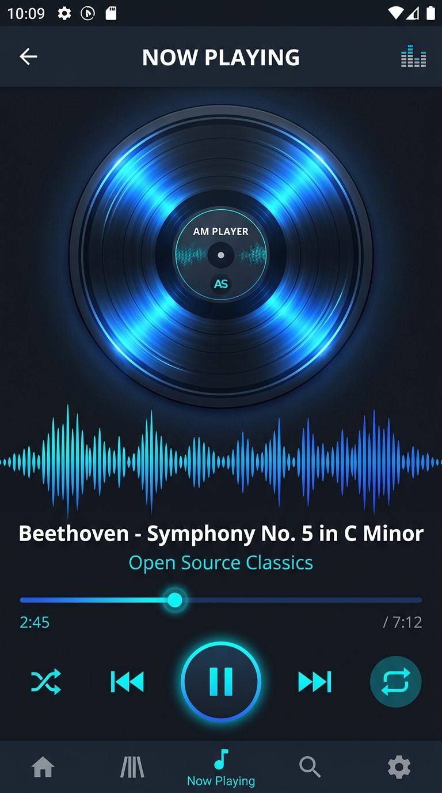
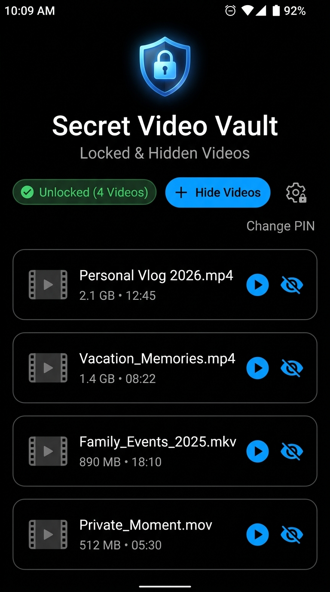
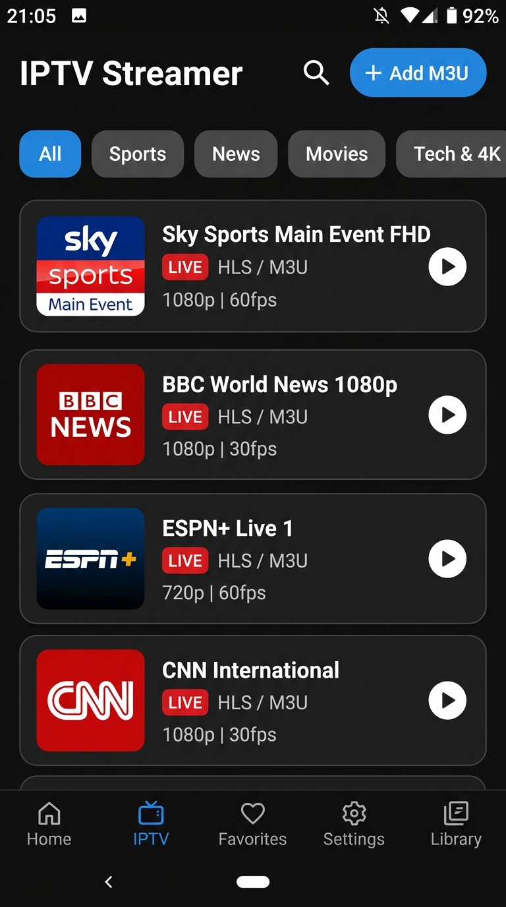
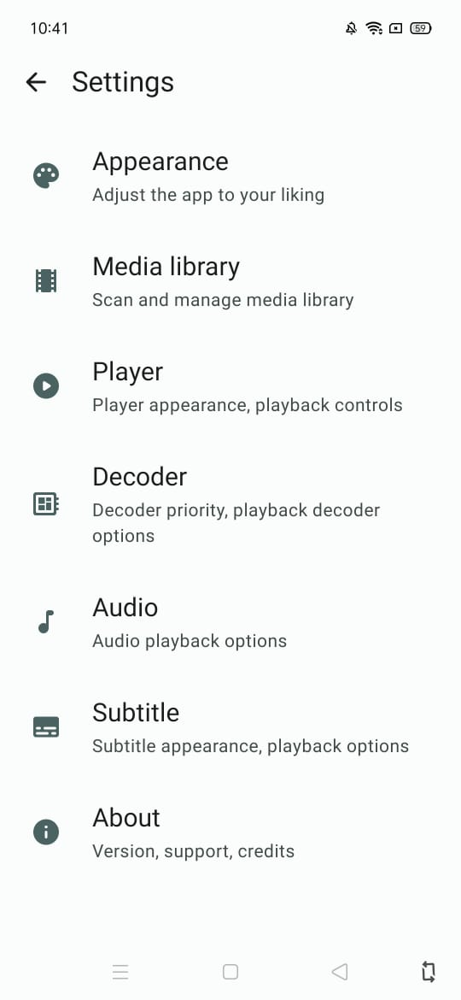

# AM Player 🎬🎵📺

<p align="center">
  
</p>

<p align="center">
  <b>The ultimate high-performance Android media player engineered with Jetpack Compose & AndroidX Media3</b>
</p>

<p align="center">
  <i>Made with ❤️ by <b>Arwinder Singh Malhi</b></i>
</p>

<p align="center">
  <a href="apk/AMPlayer-v2.4.3.apk">
    
  </a>
</p>

---

## 📥 Direct APK Download Link

You can download and install the latest compiled release APK directly on any Android device (Android 7.0+ / API 24 to Android 15 / API 35+):

- 🚀 **[Direct Download: AMPlayer-v2.4.3.apk (30 MB)](apk/AMPlayer-v2.4.3.apk)**
- 📦 **Alternative Path**: `.build-outputs/app-debug.apk`

---

## 📱 App Screenshots Gallery

| 📁 Home Video Library | 🎵 Advanced Music Player |
|:---:|:---:|
|  |  |
| *3-column folder grid, recent highlight & lightest pink play FAB* | *Rotating vinyl disc, real-time spectrum visualizer & controls* |

| 🔒 Secret Video Vault | 📺 IPTV Live Streamer |
|:---:|:---:|
|  |  |
| *5-tap unlock, secure 4-digit PIN lock, custom folders & private video manager* | *Multi-category TV & Radio M3U playlist streaming with live badges* |

| ⚙️ Minimal Settings Page |
|:---:|
|  |
| *"Made with love by Arwinder Singh Malhi" (animated heart), color picker & categorized controls* |

---

## 🔥 All Features Breakdown

### 1. 🔒 Secret Locked & Hidden Video Vault
Protect your personal and sensitive videos with a built-in security vault hidden right behind the app logo:
- **5-Tap Gesture Trigger**: Tapping the top-left AM Player main logo **5 times in a row** opens the secret vault.
- **Interactive Countdown**: Toasts guide the user on taps 2, 3, and 4 (*"Tap X more times to open Secret Vault"*).
- **First-Time Setup**: Prompts the user to set a secure 4-digit PIN with confirmation.
- **PIN Unlock**: Keypad entry with dot indicators (strictly PIN-based for maximum security).
- **Custom Vault Folders**: Create, manage, and categorize hidden videos into custom folders inside the vault.
- **Hide Any Video**: Browse and lock any video from device storage—hidden videos immediately vanish from the public library, folders, and search results.
- **Direct Playback**: Watch locked videos inside AM Player directly from the vault without unhiding them.
- **One-Tap Restore**: Restore any video back to the public library with a single tap.
- **PIN Management**: Reset or change vault PIN securely whenever needed.

---

---

### 2. 📺 IPTV Live Streamer & Radio Channels
Stream live TV channels and radio feeds with organized folder management:
- **Default TV & Radio Playlists**: Pre-configured with official TV (`tv_channels.m3u`) and Radio (`tv_radio.m3u`) streams.
- **Searchable Online Playlists**: Small search option in "Add M3U" to quickly search and select verified public playlist feeds.
- **Folder Categorization**: Separate folders per M3U playlist with clean, uniform accent-colored icons (no rainbow folders).
- **Zero Background Playback**: Videos and IPTV streams instantly stop on pressing back or switching screens.
- **HLS & Live Badges**: Real-time *LIVE* indicator pills with resolution (1080p, 720p, 4K) and frame rate.
- **Full Landscape Mode**: Opens automatically in landscape orientation for an immersive cinema view.

---

### 3. 🎵 Advanced Music Player & High-Fidelity Audio
An audio engine designed for audiophiles with instant responsiveness:
- **Multiple Browsing Views**: View and sort music library as **Songs**, **Albums**, **Artists**, or **Folders**.
- **Bidirectional Sorting**: Sort tracks by Name (A-Z, Z-A), Duration, or Artist.
- **Notification Drawer Controls**: Media controls in notification shade for seamless background playback.
- **Audiophile Engine**: 5-band Equalizer and Bass Boost (off by default for pure flat audio response).
- **Online Music Streaming**: Streaming option off by default; enable via Settings with option to add custom online streams.
- **Full-Screen Vinyl Visualizer**: Rotating vinyl disc with radial glow, audio spectrum equalizer bars, and persistent mini-player.

---

### 4. 📁 Video Library & File Management
Organize, browse, and manage device videos with speed and flexibility:
- **Zero Sample Media**: Displays exclusively actual media files stored on the user's phone.
- **Synced Grid / List View**: If folders are in grid view, videos inside are also in grid view (and vice-versa).
- **Multi-Select Video Deletion**: Select multiple videos and delete them from device storage with confirmation.
- **Subtle Recent Indicator**: Small red indicator dot on top-right of recent folder; clean transparent background in light and dark modes.
- **Redesigned Quick-Resume FAB**: Clean accent-colored circle button with a crisp white play icon.
- **Clean Interface**: Pure headers without distracting subheadings or folder clutter when viewing folder contents.

---

### 5. ⚙️ Categorized Settings & Customization
An extensive customization suite with persistent configuration:
- **Distinct Category Headers**: Uppercase, non-clickable category titles with dividers that cannot be accidentally tapped.
- **Dynamic Accent Color Picker**: Choose custom brand accent colors (Electric Blue, Emerald, Crimson, Amber, Purple, Coral, Cyan) applied across the entire app.
- **Animated Fluttering Heart**: Tapping *"Made with love by Arwinder Singh Malhi"* triggers a sweet heart flutter animation.
- **Functional Sliders & Toggles**:
  - Logo dark mode opacity slider (20% – 100%).
  - Gesture controls master toggle.
  - Double-tap seek duration (5s, 10s, 15s, 30s).
- **Pro Features**:
  - Seekbar styles (Classic, Thin, Glow, Gradient).
  - MPV engine profiles (Default, High Quality, Low Latency, Battery Saver).
  - Export & import settings to JSON.
  - Cache cleaner with exact calculated storage freed.
  - Subtitle styling and online providers.
  - Device info & open-source licenses dialog.
  - Donation dialog with UPI ID `8288909927@airtel` and embedded QR code (`upi_qr_code.jpg`).

---

### 6. 🎬 Video Player Engine & Touch Gestures
Built on AndroidX Media3 for fluid, low-latency playback:
- **Pixel-Perfect Player UI**: Matches the modern layout with top back bar, title, lock, aspect ratio, audio track selector, subtitle track selector, and menu.
- **Landscape Default**: Automatically opens video and IPTV in landscape orientation.
- **Audio & Subtitle Track Selectors**: Easily switch between embedded audio languages and subtitle tracks.
- **Double-Tap Seek Ripple Animation**: Fluid curved animated ripple rings when seeking forward or backward.
- **Notification Drawer Controls**: Video controls in Android notification bar for convenient media management.
- **Zero Background Video Playback**: Cleanly halts and releases playback immediately upon navigating back.
- **Picture-in-Picture (PiP)**: Seamless floating video window when multitasking.

---

## 🛠️ Architecture & Tech Stack

```
com.example/
├── data/
│   ├── local/              # Room Database (AppDatabase, MediaDao, SubtitleDao)
│   ├── model/              # MediaItem, AudioTrack, IptvChannel, SubtitleCandidate
│   └── repository/         # MediaRepository, MusicRepository, IptvRepository, VaultRepository, SettingsRepository
├── player/
│   ├── ExoPlayerManager.kt # AndroidX Media3 Video Engine + HW+ + Audio Boost
│   ├── MusicPlayerManager.kt # Dedicated background audio player service
│   ├── AspectRatioMode.kt  # Fit, Fill, Stretch, 16:9, 4:3, Zoom
│   └── PlayerEnums.kt      # ColorProfiles, EqualizerPresets, OrientationLock
├── ui/
│   ├── library/            # 3-Column Grid, List View, Sort Dialog, Resume FAB
│   ├── music/              # Vinyl Player, Spectrum Visualizer, Mini Player
│   ├── iptv/               # Live TV Streamer, Category Chips, M3U Dialog
│   ├── vault/              # Secret Video Vault, PIN Keypad, Biometric Unlock
│   ├── settings/           # Categorized Minimal Settings, Preferences Sheets
│   ├── player/             # Video Player Screen & Touch Gesture Overlays
│   └── theme/              # OLED Black Theme, AmAccentBlue, Typography
└── MainActivity.kt         # Edge-to-edge Jetpack Compose root
```

---

## 👨‍💻 Developer & Credits

- **Developer**: Arwinder Singh Malhi (`malhi3296@gmail.com`)
- **Version**: 2.4.3 Pro (Build 2026)
- **License**: Open Source
