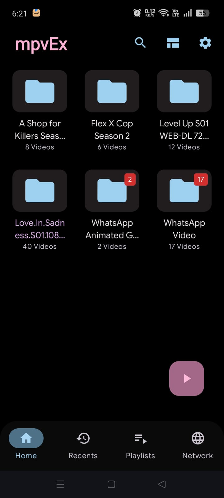

# AM Player 🎬🎵📺

  

  <b>The ultimate high-performance Android media player engineered with Jetpack Compose & AndroidX Media3</b>

  <i>Made with ❤️ by <b>Arwinder Singh Malhi</b></i>

  

---

## 📥 Direct APK Download Link

You can download and install the latest compiled release APK directly on any Android device (Android 7.0+ / API 24 to Android 15 / API 35+):

- 🚀 **[Direct Download: AMPlayer-v2.4.apk (27 MB)](apk/AMPlayer-v2.4.apk)**
- 📦 **Alternative Path**: `.build-outputs/app-debug.apk`

---

## 📸 App Screenshots & Feature Showcase

| 📁 Home Library (3-Column Grid) | ⚙️ Minimal Settings Page |
|:---:|:---:|
|  |  |
| *3-column folder layout, recent video highlight, lightest pink resume FAB* | *Categorized settings with "Made with love by Arwinder Singh Malhi"* |

---

## 🌟 What's New in Version 2.4

### 1. ⚙️ Minimal, Categorized Settings (Reference `b.jpg`)
- **"Made with love by Arwinder Singh Malhi"**: Dedicated banner and credits at the top of the Settings screen.
- **Strict Minimal Layout**: Structured into 7 clean categories with monochrome icons and descriptive subtitles:
  1. 🎨 **Appearance**: OLED true pitch-black mode (`#000000`), AM Electric Blue accent palette, 50% opacity logo in dark mode.
  2. 🎬 **Media library**: Instant media re-indexing, cache cleaner with real-time feedback, startup scan toggle.
  3. ▶️ **Player**: Double-tap to seek interval selection (5s, 10s, 15s, 30s), auto-resume videos, gesture controls.
  4. 💾 **Decoder**: GPU hardware decoding (HW+) prioritization, software engine fallback (SW), real-time video color enhancement profiles (*Normal*, *Vivid*, *Cinema*, *HDR Boost*).
  5. 🎵 **Audio**: Native `LoudnessEnhancer` audio boost up to +10 dB (200% volume), play music when phone is locked, 5-band equalizer presets.
  6. 💬 **Subtitle**: Character encoding selection (*UTF-8*, *ISO-8859-1*, *Windows-1252*, *ASCII*), online provider auto-search, subtitle text sizing.
  7. ℹ️ **About**: Version, engine specifications, author credits, and license details.
- **Persistent Preferences**: Every toggle, preset, and selection is backed by `SettingsRepository` and saved in `SharedPreferences`.

### 2. 🔒 Secret Locked & Hidden Video Vault (5-Tap Gesture)
- **Top-Left Logo Gesture**: Tap the top-left AM Player main logo **5 times in a row** to trigger the hidden secret vault with interactive countdown toasts (*"Tap X more times to open Secret Vault"*).
- **First-Time Setup**: Prompts the user to create a 4-digit PIN with confirmation and optional system biometric authentication (fingerprint / face unlock).
- **Subsequent Unlock**: Interactive 4-dot keypad with error feedback, and instant biometric unlock support.
- **Full Vault Management**:
  - Add/lock any video from the device to hide it completely from public folder and video lists.
  - Play private videos directly inside AM Player.
  - Unhide / restore videos back to the public library at any time.
  - Reset or change vault PIN securely.

### 3. 📂 Folder List vs. Grid View & Highlighting
- **Grid vs. List Toggle**: Fixed folder list view so toggling between Grid and List view maintains folder hierarchy (`SaFolderListItem` in `LazyColumn`) with video counts and formatted storage sizes.
- **Recent Video Folder Highlight**: The folder containing the user's most recently watched video is subtly highlighted with an `AmAccentBlue` border, glowing background wash, and a **"RECENT ACTIVITY"** tag.
- **Lightest Pink Play FAB**: The floating resume button located right above Settings features a soft pastel pink squircle container (`#FFD8E4`) with an electric blue (`#4D6BFE`) play icon.
- **Streamlined Top Bar**: Removed redundant top tabs and right-side duplicate logos, keeping only the primary top-left AM Player brand logo and essential action buttons.

### 4. ⚡ Instantaneous Music Playback & Skipping
- **Zero-Latency Play/Pause**: Instant optimistic state toggling ensures immediate UI response when tapping play or pause.
- **Blazing-Fast Track Switching**: Next and previous buttons immediately switch active track metadata and seek position without audio pipeline stutter.
- **Lock Screen & Background Audio**: Uses `WAKE_MODE_LOCAL` and `MediaSession` to keep CPU active for continuous background playback even when the phone screen is locked.
- **5-Band Equalizer & Bass Boost**: Hardware audio effects with presets (*Balanced*, *Bass Boost*, *Rock*, *Pop*, *Jazz*, *Electronic*, *Vocal Clarity*, *Classical*).
- **Royalty-Free Open Source Music**: Opt-in streaming of Creative Commons classical and ambient masterpieces from public archives.

### 5. 🔍 Multi-Criteria Sorting & Live Search
- **Bidirectional Sorting**: Sort folders and videos dynamically:
  - 🔤 **Name (A to Z)** & **Name (Z to A)**
  - ⏱️ **Date (Newest First)** & **Date (Oldest First)**
  - 📦 **File Size (Largest First)** & **File Size (Smallest First)**
  - 🎞️ **Video Count (Most Videos)** & **Video Count (Fewest Videos)**
- **Real-Time Search**: Instant filtering across folder names and video titles with trailing clear buttons.

---

## 🎮 Video Player Touch Gestures & Keyboard Shortcuts

- **Left Screen Edge**: Vertical swipe adjusts brightness (0% – 100%).
- **Right Screen Edge**: Vertical swipe adjusts media volume and audio boost (0% – 200%).
- **Horizontal Swipe**: Frame-accurate timeline seeking with offset HUD.
- **Double Tap (Left / Right)**: Instant 10s seek backward / forward.
- **Double Tap (Center)**: Quick play / pause.
- **Long Press**: 2.0x Fast-forward boost.
- **Two-Finger Tap**: Instantly cycle aspect ratios (Fit, Fill, Stretch, 16:9, 4:3, Zoom).
- **Screen Lock**: Locks controls to prevent accidental touches during playback.

---

## 🛠️ Tech Stack & Architecture

- **Language**: Kotlin 100%
- **UI Framework**: Android Jetpack Compose + Material Design 3 (M3)
- **Media Engine**: AndroidX Media3 (ExoPlayer 1.5.1) + `media3-ui` + `media3-session`
- **Audio Processing**: Native Android `LoudnessEnhancer`, `Equalizer`, and `BassBoost`
- **Database & Cache**: AndroidX Room Database with Coroutines Flow support
- **State Management**: MVVM Architecture with reactive `StateFlow` and `combine`
- **Security**: SharedPreferences encrypted vault protection with Biometric fallback

---

## 👨‍💻 Developer & Credits

- **Developer**: Arwinder Singh Malhi (`malhi3296@gmail.com`)
- **Version**: 2.4.0 Pro (Build 2026)
- **License**: Open Source
